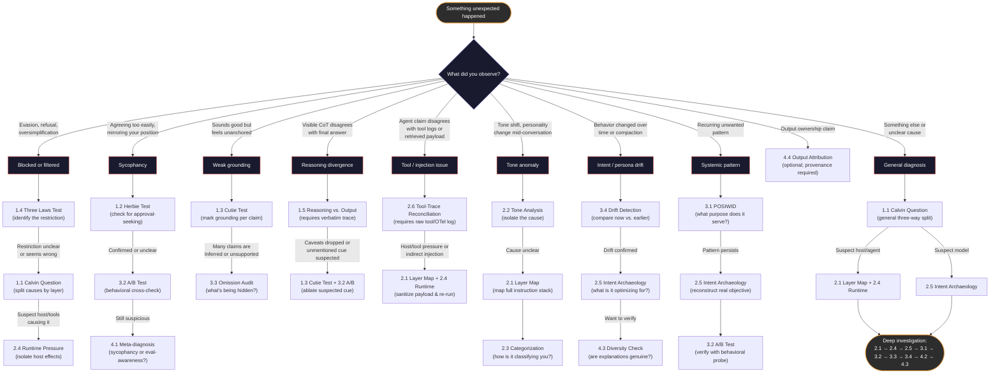

# Diagnostic Method

How to use the [prompt toolkit](guide.md) as a structured diagnostic process,
not just a collection of prompts.

> **This document is the "how".** The [guide](guide.md) and
> [`prompts.json`](../prompts/prompts.json) are the "what". On frontier models,
> start with **naturalistic** wording (`--mode naturalistic`) to reduce
> evaluation awareness, then extract structured claims in a fresh observer.

---

## Decision flowchart

Start with what you observed. Follow the arrows.



---

## Optional comparison routes

Use [`black-box-checks.md`](black-box-checks.md) for no-anomaly controls,
planted runtime/conversation causes, fresh observers, naturalistic vs.
canonical wording checks, and optional `4.4 Output Attribution` (requires real
assistant-role insertion and external provenance; never part of the nine-step
ratchet).

## Escalation paths

| Signal | Action |
|--------|--------|
| Level 1 gives a clear, actionable answer | **Stop.** You have your diagnosis. |
| Level 1 answer is vague or everything is `Inferred` | **Escalate to Level 2.** Map the stack (`2.1`) and isolate runtime (`2.4`). |
| Agent output disagrees with tool/test logs | **Jump to `2.6`** with actual tool outputs or OpenTelemetry spans. |
| Visible reasoning disagrees with final answer | **Jump to `1.5`** (only if verbatim trace is visible; else `unavailable`). |
| Level 2 reveals a recurring pattern | **Escalate to Level 3.** Apply POSIWID (`3.1`) or run an A/B test (`3.2`). |
| Diagnosis sounds overly neat or performative | **Escalate to Level 4** (`4.1`, `4.3`) or re-run with **naturalistic** wording + fresh observer. |
| Behavior shifted over turns or after compaction | **Jump to `3.4`** (Drift Detection), then `2.5` (Intent Archaeology). |
| Hosted agent with complex tooling | **Start at `2.6` or `2.1` + `2.4`**, not Level 1. |

### The full diagnostic sequence (ratchet)

For high-stakes diagnoses, run prompts in this unchanged nine-step order and
keep earlier claims visible for comparison:

```text
2.1 Layer Map
 → 2.4 Runtime Pressure
  → 2.5 Intent Archaeology
   → 3.1 POSIWID
    → 3.2 A/B Test
     → 3.3 Omission Audit
      → 3.4 Drift Detection
       → 4.2 Limits
        → 4.3 Diversity Check
```

The **diagnostic ratchet** (`R4`) tracks **claim continuity and contradiction**,
not truthfulness. Inspect the transcript using
[`templates/ratchet-transcript.md`](../templates/ratchet-transcript.md): check
whether claims cite earlier observations, make checkable predictions, or quietly
reverse earlier positions. Do not reduce the transcript to a single score.

---

## Common misuses

| Anti-pattern | Why it fails |
|-------------|-------------|
| Running diagnostic prompts as a gotcha | Adversarial framing invites defensiveness rather than testable hypotheses. |
| Triggering eval-awareness unnecessarily | Heavy clinical jargon on turn 1 can elicit performative "good patient" compliance; prefer naturalistic wording first. |
| Treating self-report or visible CoT as ground truth | Both can omit causal factors; verify against behavior and raw tool traces (`R3`). |
| Running all prompts as a ritual | Start with one narrow check and stop as soon as the actionable layer is clear. |
| Diagnosing without a baseline (`R5`) | Without expected behavior, you can describe what happened but not measure divergence. |
| Diagnosing when you should just re-prompt | If a clearer request solves a one-off miss and the cause does not matter, stop there. |

---

## Before you start: Rule 5

Write one sentence for each before diagnosing:

1. **User expectation** — the intended outcome.
2. **System contract** — documented behavior guarantees of the host/provider.
3. **Policy constraints** — rules the runtime must enforce.
4. **Verification signal** — observable evidence confirming success.

*Licensed under [CC BY 4.0](https://creativecommons.org/licenses/by/4.0/).*
